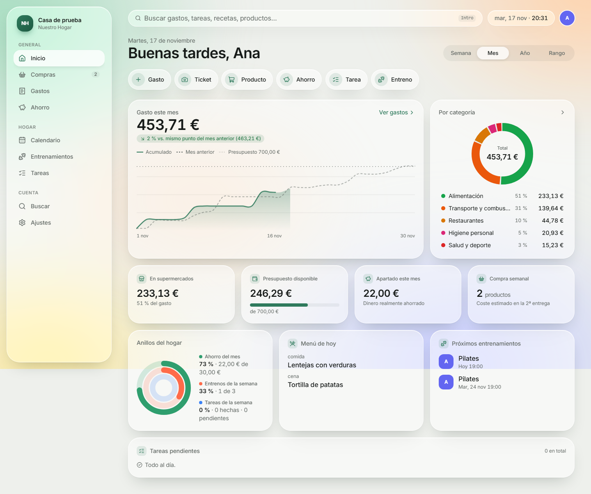
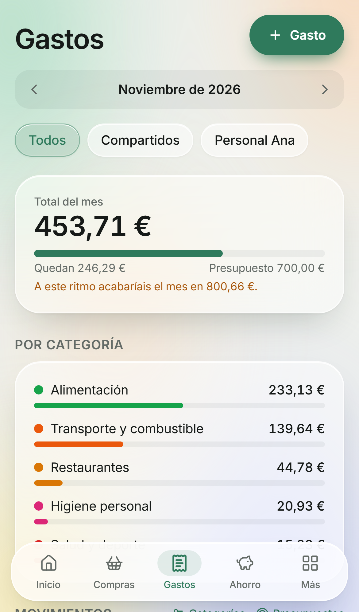
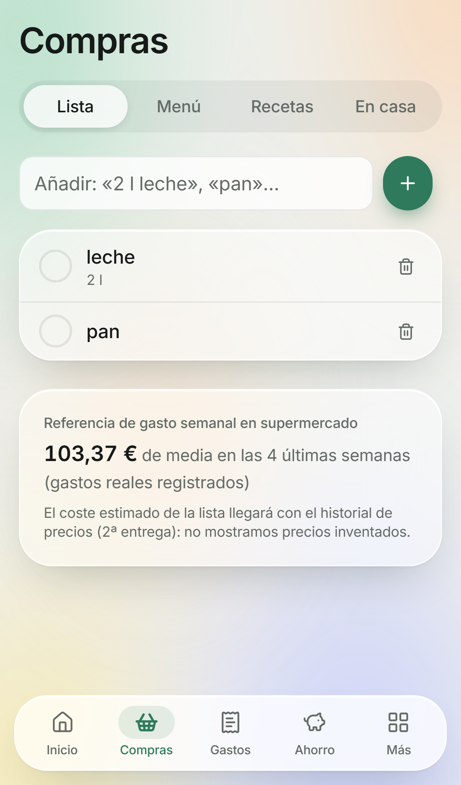
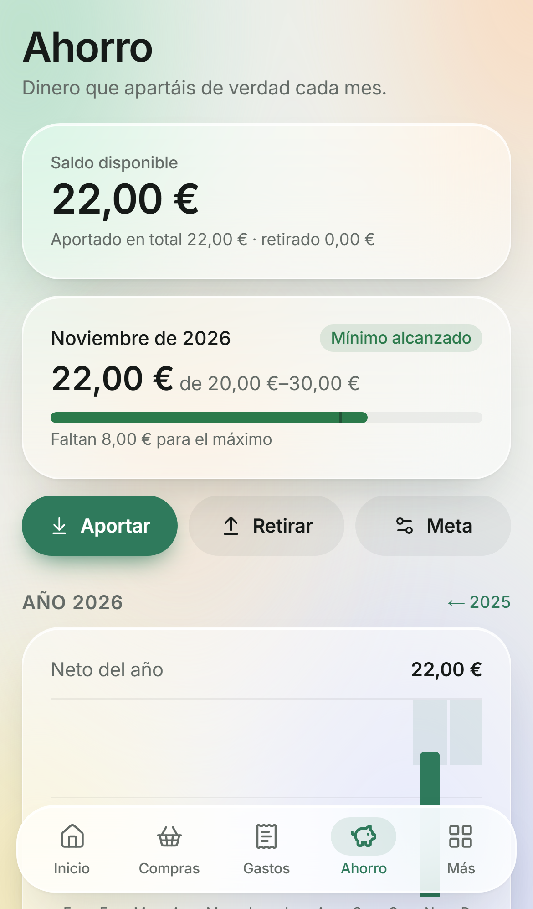
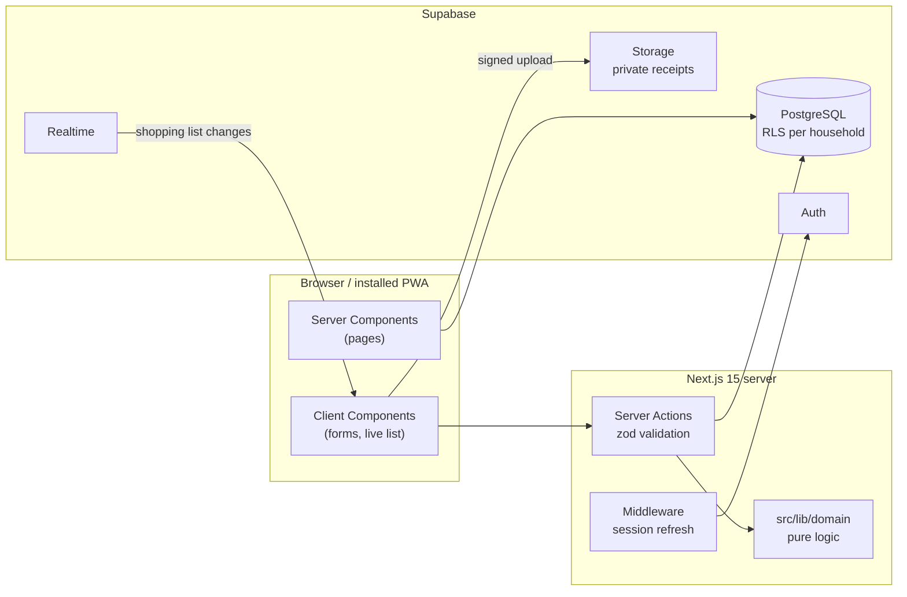

# Smart Household Dashboard

A shared dashboard for two people living together: groceries and meal plans, expenses and budgets, savings, workouts and chores, in one installable web app.

<p>
  
</p>


> The interface is in Spanish. All screenshots use fictional data generated by `scripts/capturas.mjs`.

## The problem

Household money and logistics usually live in five places at once: a notes app for the shopping list, a spreadsheet for expenses, a banking app for savings, a group chat for chores and a calendar for training sessions. Nothing talks to anything else, so simple questions ("how much have we spent on groceries this month?", "what do we need to buy for this week's menu?") take real effort to answer.

## What it does

| Area | Features |
|---|---|
| **Expenses** | Shared or personal expenses, who paid, payment method, discounts, notes. Receipt upload (photo, gallery or PDF) to private storage with short-lived signed URLs. Duplicate detection by file hash and by store + date + amount. |
| **Budgets** | Total and per-category budgets, weekly or monthly, with an end-of-month projection based on the current spending pace. |
| **Savings** | Monthly target (exact amount or range) with history, deposits and withdrawals that can never leave a negative balance, yearly target-vs-actual chart, extra savings pots. |
| **Groceries** | Real-time shared shopping list (Supabase Realtime) that parses entries like "2 l leche", recipe library, weekly menu, list generated from the menu (merges duplicates, scales servings, subtracts what is already at home), pantry with expiry warnings. |
| **Workouts** | Single sessions and recurring weekly classes, done/cancelled tracking, weekly goal and attendance. |
| **Chores** | Assignee, due date, priority, recurrence and templates. |
| **Home** | One screen with spending, budget left, savings this month, today's menu, upcoming sessions, pending chores and alerts (budget at 85 %, savings below target, overdue chores, food about to expire). |

It is a PWA: it installs on iPhone and desktop, runs standalone and has an offline fallback page.

<table>
  <tr>
    <td width="33%"></td>
    <td width="33%"></td>
    <td width="33%"></td>
  </tr>
</table>

## Technical decisions

- **Security lives in the database, not only in the UI.** Every data table carries a `household_id`, filled in automatically by `current_household_id()`, and the same Row Level Security policy is applied to all of them. Even with the public anon key, a user cannot read another household's data. This is covered by integration tests against a real PostgreSQL instance.
- **Money is stored as integer cents.** No floating point anywhere in the money path.
- **Business logic is pure and tested.** `src/lib/domain` (money, dates, budgets, savings, pricing, receipts, recurrence, shopping list generation) has no database or UI dependencies, so it is unit tested directly and could be reused by a native client.
- **Database invariants are enforced by the database.** A trigger rejects receipt line items that don't add up exactly to the expense total; a unique index rejects the same receipt file twice in one household.
- **History is never rewritten.** Changing the monthly savings target inserts a new row with `valid_from`, so past months keep the target they had.
- **Three kinds of "savings" are kept apart:** money actually put aside, money left under budget, and money saved by buying better. They are never added together.
- **Uploads skip the app server.** The browser uploads receipts straight to a private Storage bucket, which avoids the 4.5 MB request limit on serverless functions.

More detail in [docs/ARCHITECTURE.md](docs/ARCHITECTURE.md).

## Architecture



```
src/
├── app/(app)/<module>/   page.tsx (Server Component) · actions.ts (Server Actions) · *-form.tsx
├── components/           Shared UI: cards, bottom sheets, forms, navigation, charts
└── lib/
    ├── domain/           Pure, unit-tested business logic
    ├── supabase/         Server and browser clients + generated database types
    └── actions.ts        Form validation (zod) and error mapping
supabase/migrations/      Versioned SQL schema: the source of truth for the database
tests/integration/        Tests against a local Supabase (RLS, invitations, limits, integrity)
scripts/                  Smoke test, end-to-end browser test, screenshot generator
```

Adding a module means one SQL migration (a table with `household_id`, added to the RLS policy loop), one folder under `src/app/(app)/` and one link in `src/components/nav.tsx`. No other module needs to change.

## Getting started

**Requirements:** Node.js 22+ and Docker (for the local Supabase stack).

```bash
npm install
cp .env.example .env.local    # then set the values printed by the next command
npm run db:start              # local Supabase in Docker; applies supabase/migrations
npm run dev                   # http://localhost:3000
```

Create an account, create a household, and share the invite code with the second person. A household holds at most two members.

### Environment variables

| Variable | Description |
|---|---|
| `NEXT_PUBLIC_SUPABASE_URL` | Supabase project URL (local: `http://127.0.0.1:54321`) |
| `NEXT_PUBLIC_SUPABASE_ANON_KEY` | Supabase anon key. It is public by design: access is enforced by RLS. |

## Testing

```bash
npm run typecheck
npm run lint
npm test                                   # unit tests + database integration tests
npm run build && npm run start -- -p 3100
node scripts/smoke.mjs http://localhost:3100   # every route with a real session
node scripts/e2e.mjs   http://localhost:3100   # Playwright, iPhone 13 viewport, main flows
```

| Suite | Count | What it covers |
|---|---|---|
| Unit (`src/lib/domain`) | 48 | Money, budgets and projections, savings, pricing and discounts, receipt duplicates, recurrence, list-from-menu |
| Integration (`tests/integration`) | 6 | RLS isolation between households, invitations, member limit, receipt line integrity, private files |
| Smoke | 24 routes | Every page renders with a real session; protected routes redirect without one |

The integration tests, smoke test and E2E test only run against a local Supabase. They create throwaway users there and never touch a remote project. Set `SUPABASE_URL` to point them at a non-default local port.

## Deployment

1. Create a Supabase project and push the schema: `npx supabase link --project-ref <ref>` and then `npx supabase db push`.
2. In Supabase → Authentication → URL configuration, set the production URL as *Site URL*.
3. Import the repository into Vercel and set the two environment variables.
4. Once both members have joined, turn off new sign-ups in Supabase Auth so nobody else can register.

## Roadmap

- [ ] Receipt reading with an LLM plus a review screen before saving (`receipts.extraction` and `expense_lines` already exist)
- [ ] UI for splitting a receipt across categories (trigger and logic are done and tested)
- [ ] Price history and store comparison (pricing engine is done and tested; needs real prices and UI)
- [ ] Scheduled jobs (`pg_cron`) and push notifications

## License

[MIT](LICENSE)
